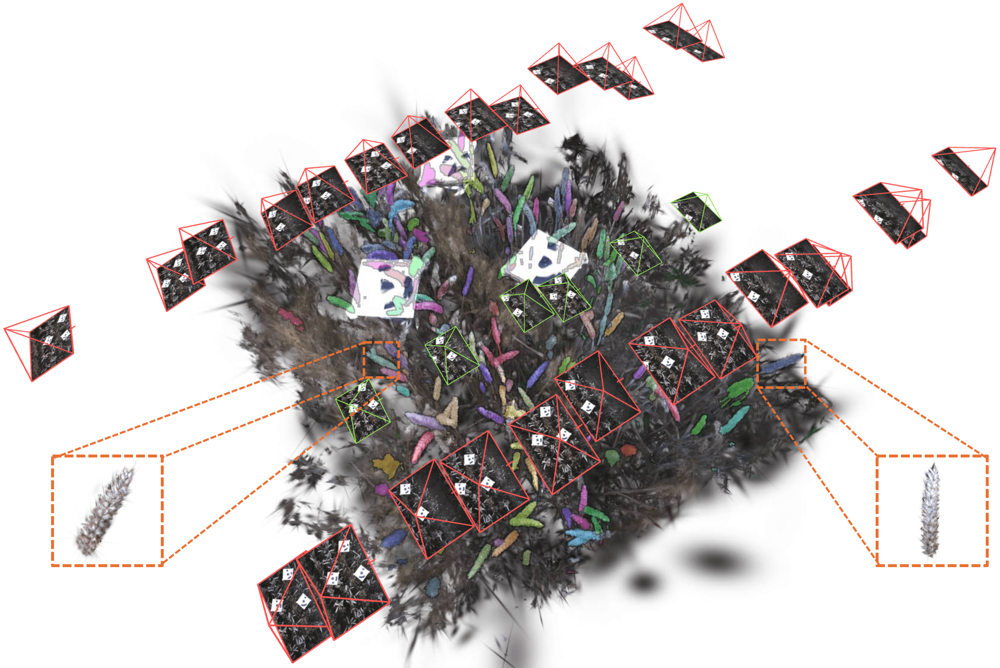
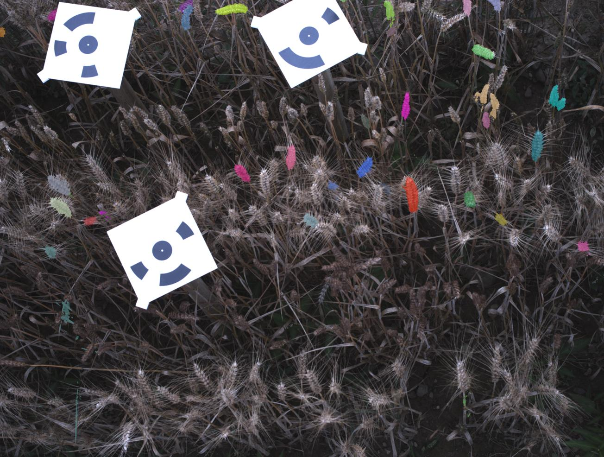
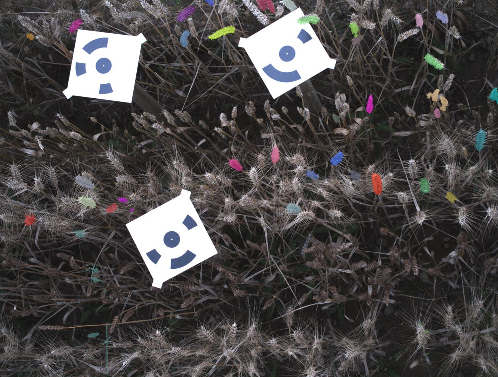

<p align="center">
  <h2 align="center">🌾 Wheat3DGS <br> In-field 3D Reconstruction, Instance Segmentation and Phenotyping of Wheat Heads with Gaussian Splatting</h>
  <h3 align="center">CVPR 2025 Agriculture-Vision Workshop</h3>
</p>

<div align="center"> 

[Project Page](https://joaquin-gajardo.github.io/wheat3dgs/) | [Paper](https://openaccess.thecvf.com/content/CVPR2025W/V4A/html/Zhang_Wheat3DGS_In-field_3D_Reconstruction_Instance_Segmentation_and_Phenotyping_of_Wheat_CVPRW_2025_paper.html) |  [Arxiv](https://arxiv.org/abs/2504.06978) | [Data](https://drive.google.com/drive/folders/1DJPs_E8-93dCysYkQ0-uxHrAcZGTZiVh)

  
</div>

## Updates
- <b>[5/16/2025]</b> 3D gaussian segmentation viewer
- <b>[5/2/2025]</b>  Thx [Tomi](https://github.com/tomedic) for releasing code for wheat head morphology calculation at `wheatheadsmorphology`!
- <b>[4/30/2025]</b> Initial code release 

## 📝 TODO List
- [ ] Share Docker setup
- [x] Script to get initial masks
- [ ] Data to ETH research collection including laser scans

## 🛠️ Setup
The setup should be very similar to the original [3D Gaussian Splatting](https://github.com/graphdeco-inria/gaussian-splatting) except we used a modified version of [differential gaussian rasterization](https://github.com/ashawkey/diff-gaussian-rasterization/tree/8829d14f814fccdaf840b7b0f3021a616583c0a1) with support of depth & alpha rendering, and an additional [flashsplat-rasterization](https://github.com/florinshen/flashsplat-rasterization/tree/189c483ffa33dd6d5661343ce496df0c6eb80a0c) submodule. 

```
git clone --recursive https://github.com/zdwww/Wheat-3DGS.git
conda env create --file environment.yml
conda activate wheat3dgs
```

## 🌾 Dataset
[Data](https://drive.google.com/drive/folders/1DJPs_E8-93dCysYkQ0-uxHrAcZGTZiVh) used for Wheat3DGS and the baseline results for each plot (from 461 to 467) are structured as follows:
```bash
plot_46x/
├── images/ # 36 images captured by FIP
│   ├──FPWW036_SR0461_FIP2_cam_01.png 
│   └──FPWW036_SR0461...
├── sparse/ # camera intrinsics/extrinsics in COLMAP format
├── yolosam.zip # 2D masks formatted for Wheat3DGS, unzip in plot_46x/ to get the folders below
│   ├──bboxes/ # YOLO bounding boxes per image (xyxy)
│   │  ├──FPWW036_SR0461_1_FIP2_cam_01.pt
│   │  └──...
│   └──masks/ # 2D segmention mask corresponds to each box (per instance per image) 
│   │  ├──FPWW036_SR0461_1_FIP2_cam_01_000.png
│   │  ├──FPWW036_SR0461_1_FIP2_cam_01_001.png
│   │  └──...
│   ├──yolo_vis/ # for visualization purpose only
│   └──sam_vis/ # for vis only
├── semantics/ # combined 2D masks per image for FruitNeRF baseline
├── manual_label/ # contains a randomly selected test view image with human-annotated wheat heads
└── transforms.json # data in NeRF format
```
Please unzip `yolosam.zip` for each plot before running the 3D segmentation, inside the plot folder (`cd plot_46x && unzip yolosam.zip`), so that `bboxes/` and `masks/` end up directly in `plot_46x/` (a `plot_46x/yolosam/` subfolder, as created by some GUI unzip tools, also works). The image names are structured as follows. For example, in `FPWW036_SR0461_FIP2_cam_01.png`: `FPWW036_SR0461` is shared by all images from the same plot; `FIP2` indicates the batch ID, which may appear as `1_FIP2`, `6_FIP`, or `FIP2`; and the final element `01` is the camera ID, ranging from `01` to `12`. Our data preprocessing functions already handle the naming convention correctly. To get a clearer view of how the cameras are positioned in 3D space and how the train/test views are distributed, please run `vis_cam.py` for visualization.

## 💻 Using Wheat3DGS

### Quick start

The majority of the Wheat3DGS pipeline can be executed by running this script.
```
sbatch run_wheat_3dgs.sh
```

### Step-by-step instructions

<details>
<summary><b>Step 0 (Optional).</b> Camera poses from your own images with Agisoft Metashape (click to expand)</summary>

Our dataset already contains the undistorted images and camera poses (`images/`, `sparse/`). To make them from your own images, `scripts/preprocessing/` aligns and georeferences the cameras in [Agisoft Metashape](https://www.agisoft.com/) (needs a Metashape Professional license and its Python module from the [downloads page](https://www.agisoft.com/downloads/installer/)):
```bash
# marker files (one per plot) from a GNSS survey of the coded targets, CSV lines <plot>-<target>,x,y,z
python scripts/preprocessing/gnss_to_markers.py --gnss_csv <survey.csv> --out <markers_dir>
# align, georeference and export as COLMAP (undistorted pinhole, principal point at the image centre), in LV95 by default
python scripts/preprocessing/metashape_to_colmap.py --images <raw_images> --markers <markers_dir>/plot_461_coordinates.txt \
    --project <out>/agisoft.psx --out <out>/colmap
# move the origin to the mean camera centre, writes <dataset_path>/sparse/0 and <dataset_path>/cam_centroid.npy
# (--distorted: also the cameras with their distortion model + the marker pixels, in <dataset_path>/distorted/)
python scripts/preprocessing/recenter_colmap.py --src <out>/colmap/sparse/0 --out <dataset_path> \
    --distorted <out>/colmap/distorted/sparse/0
mv <out>/colmap/images <dataset_path>/images
```
The 3DGS camera model assumes the principal point at the image centre, which the pinhole export ensures. Export in a projected CRS (`--crs`, default LV95 = EPSG:2056; `--crs local` for markers measured in local metres, with z up): the scene is then in metres around the mean camera centre, and world coordinates = scene coordinates + `cam_centroid.npy`. With `--mvs`, `metashape_to_colmap.py` also builds the MVS dense point cloud and exports it as E57. It stops if fewer than 3 targets with coordinates are found, since the export would then not be georeferenced. Marker detection differs between Metashape versions (tested with 2.2.1, which misses a partly covered target that 2.1 finds); add a missed target's pixels with `--marker_pixels <csv>` (`Marker,Camera,X,Y` in the raw images).

</details>
<br>

**Step 1.** To train a vanilla 3DGS scene reconstruction using wheat plot images as initialization:
```
python train_vanilla_3dgs.py -s <dataset_path> -m <model_path> --resolution 1 --eval
```
Note that `resolution` is set to 1 to prevent image downscaling, and the training/test split for evaluation follows the default setting of our dataset.

You can also run `render.py` and `metrics.py` with the same input arguments to evaluate the quality of novel view synthesis on the reconstructed wheat fields (see Sec. 5.1). 

**Step 2 (Optional).** The wheat head bounding boxes (YOLOv5) and 2D segmentations (SAM) are already provided in our dataset (`yolosam.zip`). To generate them yourself, e.g. for new data, download the [wheat head detection weights](https://drive.google.com/drive/folders/1DCf23OqiMp68aWDc1fd33gnukI5kQ_j0) (`wheat_head_detection_model.pt`, from the [winning solution](https://github.com/ksnxr/GWC_solution) of the Global Wheat Head Detection Challenge 2021) and the [SAM ViT-H checkpoint](https://dl.fbaipublicfiles.com/segment_anything/sam_vit_h_4b8939.pth) into `weights/`, then run:
```
python scripts/generate_masks.py -s <dataset_path> [<dataset_path> ...]
```
This writes `bboxes/` and `masks/` into each plot folder (or into another folder with `--out`, e.g. to keep several mask sets side by side; select one with `--masks_dir`, see Step 3). `--vis` also saves `yolo_vis/` and `sam_vis/`. The defaults (`--conf 0.25`, `--img_size 640`) reproduce the provided masks. YOLOv5 is included as a submodule (`submodules/yolov5`, tag `v7.0`, [AGPL-3.0](https://github.com/ultralytics/yolov5/blob/master/LICENSE)) and needs `seaborn` and `thop`, plus [`segment-anything`](https://github.com/facebookresearch/segment-anything) for SAM (all included in the Docker image). 

#### Use your own 2D masks
To use your own 2D masks instead (e.g. from another segmentation model), put them in a folder with this layout and pass it to the 3D segmentation with `--masks_dir` (see Step 3):
- `masks/<image_name>_000.png`, `_001.png`, ...: one binary mask per object (pixels > 0 = object), same size as the image.
- `bboxes/<image_name>.pt`: a `torch` float tensor of shape N × 4 with one box `(x1, y1, x2, y2)` in image pixels per mask, row *i* belonging to mask `_<i>` (e.g. the outer box of each mask).

**Step 3.** To run 3D segmentation on a wheat plot to identify and associate decoupled 2D wheat heads. To reproduce the paper's results (Table 2), use `run_3d_seg_paper.py`, the algorithm the paper's results were produced with:
```
python run_3d_seg_paper.py -s <dataset_path> -m <model_path> --exp_name run1 --seed 0
```
`run_3d_seg.py` is a later version of the algorithm. After the first match it iteratively re-renders and re-matches the wheat head in the remaining views, accepts wheat heads matched in only two views, and merges a new wheat head into a previously found one when they largely overlap. It segments more of each wheat head (higher recall in Table 2), but merges neighbouring wheat heads more often:
```
python run_3d_seg.py -s <dataset_path> -m <model_path> --iou_threshold 0.6 --exp_name run1 --seed 0
```
| Parameter | Type | Description |
| :-------: | :--: | :---------: |
| `--iou_threshold` | `float` | The IoU threshold for associating rendered and YOLO-SAM-generated 2D segmentations. A higher threshold results in more conservative mask matching. Paper: 0.6 (default of `run_3d_seg_paper.py`). |
| `--num_match` | `int` | `run_3d_seg_paper.py` only: number of views (including the starting view) a wheat head must be matched in. Paper: 5 (default). |
| `--seed` | `int` | Random seed for the order in which the 2D masks are processed. The same seed gives the same result. |
| `--exp_name` | `str` | The experiment name used to create the folder for saving all results under `<model_path>/wheat-head`.
| `--no_height_filter` | flag | Lift each seed mask to all Gaussians, not only those above the mean height of the scene (the default removes the ground and is meant for wheat heads; use this for other objects). |
| `--masks_dir` | `str` | Folder containing `bboxes/` and `masks/`, as a subfolder of `<dataset_path>` (e.g. `yolosam_1280`) or an absolute path. Default: `<dataset_path>` itself, or `<dataset_path>/yolosam`. |

**Note on duplicate wheat heads.** Each wheat head found is saved as `ply/wh_XXXX.ply`, and these files can contain duplicates of the same physical head, because masks already used for one head can be matched again by a later one. In our tests (grouping heads with a Jaccard overlap above 0.5 on their Gaussians), removing duplicates barely changes per-head trait errors against the laser scans, but head counts and ANOVA F values are inflated by them.

**Step 4.** To generate a video rotating around the reconstructed wheat field for **qualitative** evaluation of the 3D segmentation results (as shown on our project page), run:
```
python render_360.py -s <dataset_path> -m <model_path> --render_type <field or head> --exp_name run1 --n_frames 200 --framerate 20 --elevation 45
```
| Parameter | Type | Description |
| :-------: | :--: | :---------: |
| `--render_type` | `field` or `head` | Either render a video rotating around the entire reconstructed wheat field with the 3D segmentation overlaid on it, or a list of close-up videos of individual identified wheat heads. |
|`--n_frames` | `int` | Number of video frames (It’s recommended to set a relatively small value for wheat heads, as hundreds of them will be processed.)|
|`--framerate`| `int` | Framerate. Length of video = `n_frames / framerate`|
|`--elevation`| `int` | Elevation angle for the camera trajectory rotating around the scene. The larger the angle, the more novel the rendered view is, since the training views are captured by an overhead camera. |

Results will be saved as a video `<model_path>/wheat-head/<exp_name>/wheat_field_360.mp4` for the whole wheat field and a list of videos under the directory `.../<exp_name>/wheat_head_360` for each wheat head id.

**Step 5.** To **quantitatively** evaluate the quality of 3D segmentation and reproduce Table 2 in the paper (with a segmentation from `run_3d_seg_paper.py`), project the 3D segmentation into 2D by
```
python eval_wheatgs.py -s <dataset_path> -m <model_path> --exp_name run1 --skip_train --load_counts
```
Rendered 2D segmentation will be saved under `<model_path>/wheat-head/<exp_name>/eval/test/segmentation` and `overlay`, next to the 3D segmentation results. Then compute the metrics of Table 2 (IoU, precision, recall, F1, MSE, SSIM) against the manual labels (`<dataset_path>/manual_label/`), per plot and averaged over plots:
```
python evaluate_2D.py -s <dataset_path_1> <dataset_path_2> ... -m <model_path_1> <model_path_2> ... --exp_name run1
```
The metrics and an overlay per view (red: overlap, gray: label only, light red: prediction only) are saved in `<model_path>/wheat-head/<exp_name>/eval/test/`. For masks of another method, give `--pred_dir <folder>` (one per dataset path, masks named like the views) instead of `-m` and `--exp_name`.

**Step 6.** To compare the traits of the segmented wheat heads with laser scans (TLS) and dense photogrammetry (MVS), as in Tables 3 and 4 of the paper, first export the heads of each plot in Swiss coordinates (LV95), then run the comparison. It needs the TLS and MVS point clouds of our data release:
```bash
for plot in 461 462 463 464 465 466 467; do
  python scripts/phenotyping/export_heads.py -s data/plot_$plot -m output/plot_$plot --exp_name run1 --out heads/${plot}_1707
done
python scripts/phenotyping/s0_run_all.py --data_dir <data_release> --heads_dir heads --results_dir <results>
```
The TLS and MVS heads are cut out of the plot point clouds with bounding boxes fitted to the exported heads. Although the Wheat3DGS heads can be reproduced closely, the newly cut TLS and MVS heads differ from the paper's (the paper's TLS heads are larger, possibly due to older different HDBSCAN or SOR filtering parameters in [step 5](scripts/phenotyping/s5_wheatheadmorphology.py)), so the trait comparison gives different numbers than Tables 3 and 4. To reproduce Tables 3 and 4 of the paper, run the comparison on the paper's head point clouds of all three methods, included in the data release:
```bash
python scripts/phenotyping/s0_run_all.py --data_dir <data_release> --paper_heads_dir <data_release>/03_results/paper_heads --results_dir <results>
```
| Parameter | Type | Description |
| :-------: | :--: | :---------: |
| `--heads` | `saved` or `final` | `export_heads.py`: `saved` (default, used in the paper) exports the per-head files in `ply/`, which can contain duplicates (see the note in Step 3). `final` exports the head labels left in `gaussians.ply` at the end of the run, which don't overlap. |
| `--paper_heads_dir` | `str` | `s0_run_all.py`: instead of `--heads_dir`, a folder with heads already cut for all three methods (`gs/`, `tls/`, `mvs/`, one subfolder per plot, in the coordinate system of the point clouds). Only the trait and statistics steps run. |
| `--icp_dir` | `str` | `s0_run_all.py`: only for the paper's reconstructions, which are shifted by 1-2 cm relative to the MVS point clouds: `<data_release>/02_point_clouds/transformations/gscs_to_pcs`. Not needed for the corrected dataset. |
| `--seed` | `int` | `s0_run_all.py`: random seed for subsampling heads with more than 5000 points. The same seed gives the same result. |
| `--min_points` | `int` | `s0_run_all.py`: heads with fewer points are skipped and reported. Default: 50. |

Traits per head are saved in `<results>/traits_and_genotypes_all_methods` and the tables in `<results>/statistics_tables_3_and_4`. The expected data layout is described in `s0_run_all.py` and the individual steps in `scripts/phenotyping/Readme.txt`. Note that per-row values depend noticeably on the random subsampling, so small differences between runs or methods in those columns are not meaningful.

## Baseline
To reproduce the baseline results presented in the paper (i.e. [FruitNeRF](https://github.com/meyerls/FruitNeRF)), please refer to the original repository and the scripts in the `scripts` folder.

<!-- ## Results
<p align="center">
  
  
</p> -->

## Visualization
Our viewer is based on [viser](https://github.com/nerfstudio-project/viser) and [nerfview](https://github.com/nerfstudio-project/nerfview). It shows the reconstructed plot in the browser, with every segmented wheat head (final heads, `gaussians.ply` of a Step 3 run) in its own colour, and the training/test cameras in red/green (click a camera to jump to its view). "Colour by" switches between these final heads, duplicates among the saved heads (`ply/`, the heads used in Step 6: Gaussians in 1 / 2 / 3 or more saved heads in green / yellow / red, i.e. heads saved more than once) and the original appearance; "Saved head" shows one saved head together with the saved heads sharing at least half of its Gaussians.
```
cd wheat3dgsviewer
bash run.sh <dataset_path> <model_path> <exp_name> [port]
```
Then open `http://localhost:8080`. On a remote machine, forward the port (e.g. `ssh -L 8080:localhost:8080 <host>`, or the Ports panel of VS Code Remote); with Docker, add `-p 8080:8080` to `docker run`. Navigation: left-drag to orbit, right-drag to pan, scroll to zoom; `W`/`S` forward/back, `A`/`D` left/right, `Q`/`E` down/up, arrow keys to turn. Requires `viser==1.0.26 nerfview==0.1.3 splines jaxtyping` (included in the Docker image).

## Acknowledgement
Our implementation is based on the original [3D Gaussian Splatting](https://github.com/graphdeco-inria/gaussian-splatting) and [FlashSplat](https://github.com/florinshen/FlashSplat). We thank the authors for their revolutionary work and open-source contributions.

## License
This project is licensed under the MIT License - see the [LICENSE](LICENSE.md) file for details. Please note that the 3D Gaussian Splatting code base, however, is licensed under a different license, which can be found in the [LICENSE_3DGS](LICENSE_3DGS.md) file.

## Citation
If you find our paper useful, please cite us:
```bib
@InProceedings{Zhang_Gajardo_2025_CVPR,
    author    = {Zhang, Daiwei and Gajardo, Joaquin and Medic, Tomislav and Katircioglu, Isinsu and Boss, Mike and Kirchgessner, Norbert and Walter, Achim and Roth, Lukas},
    title     = {Wheat{3DGS}: {I}n-field {3D} {R}econstruction, {I}nstance {S}egmentation and {P}henotyping of {W}heat {H}eads with {G}aussian {S}platting},
    booktitle = {Proceedings of the Computer Vision and Pattern Recognition Conference (CVPR) Workshops},
    month     = {June},
    year      = {2025},
    pages     = {5369-5379}
}
```
